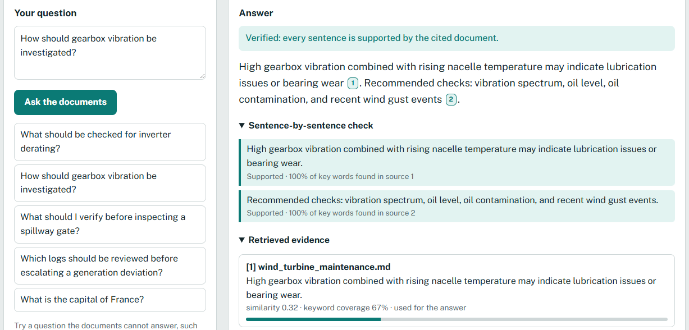
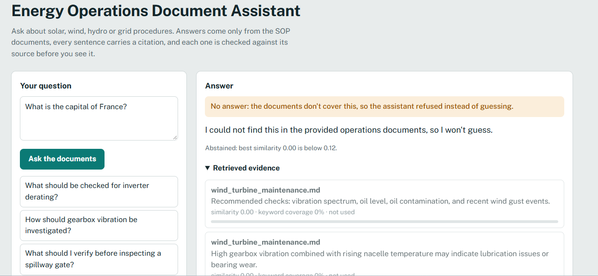
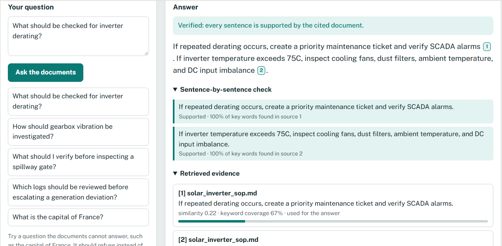
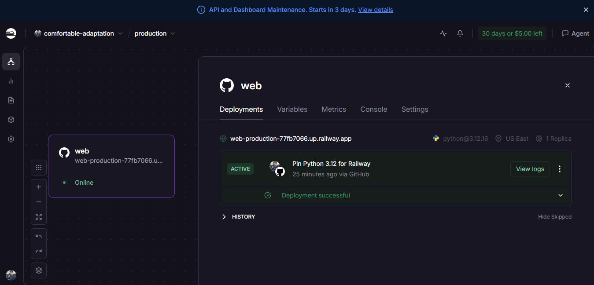

# Energy Operations Document RAG Assistant

**Live demo:** https://web-production-77fb7066.up.railway.app

A document assistant for renewable-energy operations. An engineer asks a question
("What should be checked for inverter derating?") and gets an answer **taken only from the
SOP documents**, with **citations**, the **retrieved evidence**, and a **hallucination check**
on every sentence. If the documents don't cover the question, it **refuses** instead of guessing.

## Screenshots

| Cited and verified answer | Out-of-scope refusal |
|---|---|
|  |  |

| Second cited answer | Railway deployment |
|---|---|
|  |  |

## Quick start

```bash
python -m venv .venv && source .venv/bin/activate     # Windows: .venv\Scripts\activate
pip install -r requirements.txt
uvicorn backend.app:app --reload                       # open http://127.0.0.1:8000
python -m evaluation.run_eval                          # evaluation report
python -m pytest -q                                    # tests
```

No API key or internet is needed: the default mode is fully offline.

## How it works (input -> process -> output)

```
question
  -> 1 chunking      split each .md SOP into sentence-aware chunks (backend/chunking.py)
  -> 2 embedding     TF-IDF vectors over stemmed words + bigrams (backend/retriever.py)
  -> 3 retrieval     cosine similarity, top-k, plus neighbour chunks of the best match
  -> 4 decide        too dissimilar / too few question keywords found?  -> REFUSE
  -> 5 generate      extractive answer (default) or optional LLM, every sentence tagged [n]
  -> 6 verify        hallucination guard checks each sentence against its cited chunk
  -> JSON: answer, citations, retrieval scores, per-sentence check, mode, notes
```

| Step | Design choice | Why |
|---|---|---|
| Chunking | Pack whole sentences up to 20 words; never cut mid-sentence; title kept as context | A citation must be a readable passage. Sentence chunks keep the exact instruction intact. |
| Embeddings | TF-IDF (1-2 word grams, light stemming, stop-words removed) | Runs offline, instant, fully explainable. Weakness: matches words, not meaning (see limitations). |
| Retrieval | Cosine top-k + neighbour expansion | The sentence that answers a question often sits next to the best-matching one. |
| Refusal | Refuse if best similarity < 0.12 or < 50% of question keywords appear in the best chunk | In a safety setting "I don't know" beats a confident guess. |
| Generation | Extractive by default; optional LLM (`LLM_PROVIDER=anthropic`) | Extractive answers cannot invent facts. The LLM mode reads better, but its draft must pass the guard or we fall back to extractive. |
| Guard | Per sentence: has valid citation, >= 80% of key words in cited chunk, all numbers present, no new negation | Deterministic and explainable: it tells you *why* a sentence failed. |

**Not used:** no agent (the flow is a fixed pipeline, not a model choosing tools). RAG **is** used
because answers are built from retrieved document chunks.

## Evaluation (`python -m evaluation.run_eval`)

Data: 10 answerable + 6 out-of-scope questions (`data/eval_questions.csv`), plus 11 hand-written
answers to test the guard.

| Metric | Result |
|---|---|
| Retrieval hit@1 / hit@3 / MRR | 10/10 / 10/10 / 1.00 |
| Answerable questions wrongly refused | 0/10 |
| Out-of-scope questions correctly refused | 6/6 |
| Guard: fabricated answers caught | 7/8 |
| Guard: faithful answers wrongly flagged | 0/3 |

**Read these numbers with care.** The corpus is 4 documents (6 chunks) and the questions were
written by the same person who built the system, so scores are optimistic and say little about
real-world accuracy. Two settings were changed *after* seeing early eval failures, so they are
tuned to this small set: keyword-coverage cutoff 0.4 -> 0.5 (a "blade replacement" question
matched only on the words "wind turbine"), and guard support 0.6 -> 0.8 (a half-invented
sentence slipped through). The one guard miss is a known blind spot: *"...if the inverter
temperature is **below** 75C"* reuses the source's words but reverses the meaning.

## Limitations

- TF-IDF is lexical: "overheating" will not match "temperature exceeds" unless words overlap.
- The guard checks word support, not meaning, so reworded reversals can pass (shown above).
- Answer sentences follow retrieval rank, not the document's own order, so a later step can
  appear before an earlier one (visible in the inverter screenshot).
- Tiny corpus; no PDFs, tables or versioning; no authentication; no conversation memory.
- The optional LLM mode was tested only with a stubbed model (good draft, hallucinated
  draft, "insufficient" reply, network error all behave correctly); run it once with a real key
  before relying on it.

## Production-readiness gaps / next steps

1. Replace TF-IDF with neural embeddings plus a vector store; keep TF-IDF as a hybrid (BM25) signal.
2. Add an entailment (NLI) model or LLM-as-judge to the guard to catch meaning reversals.
3. Order answer sentences by their position in the source document.
4. Larger, independently written evaluation set; track metrics in CI.
5. Document ingestion for PDF/Word, document versions and effective dates, access control.
6. Logging, rate limiting, and human feedback on answers.

## Configuration (all optional)

Copy `.env.example`. Never commit real keys; set them as Railway variables.

| Variable | Meaning |
|---|---|
| `LLM_PROVIDER=anthropic` | Turns on LLM answers (needs the key below) |
| `ANTHROPIC_API_KEY` | Secret key, set in Railway -> Variables |
| `ANTHROPIC_MODEL` | Defaults to `claude-haiku-5-5` |

## API

- `GET /` frontend, `GET /api/health`, `GET /api/sources` (all chunks)
- `POST /api/ask` with `{"question": "...", "top_k": 3}`

## Deploy to Railway

1. Push this folder to a GitHub repository (the `.gitignore` already excludes `.env`).
2. Sign in at railway.com -> **New Project** -> **Deploy from GitHub repo** -> pick the repo.
3. Railway detects Python from `requirements.txt` and starts the app with the `Procfile`:
   `web: uvicorn backend.app:app --host 0.0.0.0 --port $PORT`. A `.python-version` file
   containing `3.12` pins the Python version; without it Railway chose 3.13 and the first
   deployment crashed with the pinned package versions.
4. Open the service -> **Settings -> Networking -> Generate Domain**.
5. Visit `https://<your-domain>/api/health`. Expect `{"status":"ok","chunks":6,...}`, then open the root URL.
6. (Optional) **Variables** tab: add `LLM_PROVIDER`, `ANTHROPIC_API_KEY`.
7. Deployed at https://web-production-77fb7066.up.railway.app (see the Railway screenshot above).

If a build fails, check the deploy logs; the usual causes are a Python-version or pinned-package
mismatch, fixed by editing `.python-version` or `requirements.txt`.